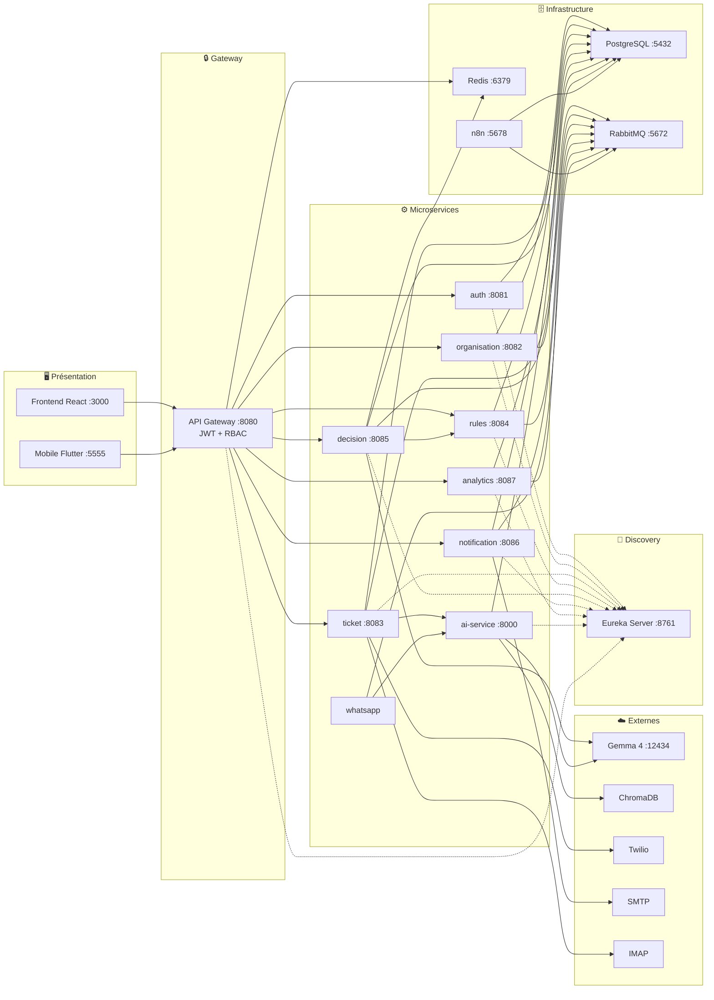

# Spécification du Diagramme d'Architecture Physique AutoAssist

## Objectif
Créer un **diagramme de déploiement** professionnel montrant les **17 conteneurs Docker** du système AutoAssist, organisés en 5 couches. Le diagramme doit être en format **paysage** (landscape), clair, lisible, et occuper toute la page A4 en mode paysage.

## Dimensions cibles
- Format : **paysage A4** (297mm × 210mm)
- Résolution : minimum **3000×2000 pixels** à 300 DPI
- Fond blanc

---

## Architecture : 5 couches (de gauche à droite ou de haut en bas)

### 1. 🖥️ Couche Présentation (2 conteneurs)
| Conteneur | Technologie | Port |
|-----------|------------|------|
| **Frontend React** | React 18 + Vite | 3000 |
| **Mobile Flutter** | Flutter Web | 5555 |

### 2. 🔒 Couche Gateway (1 conteneur)
| Conteneur | Technologie | Port |
|-----------|------------|------|
| **API Gateway** | Spring Cloud Gateway | 8080 |
> Fonctions : JWT validation, RBAC filter, Rate Limiter (Redis)

### 3. 📡 Couche Discovery (1 conteneur)
| Conteneur | Technologie | Port |
|-----------|------------|------|
| **Eureka Server** | Netflix Eureka | 8761 |
> Tous les microservices + gateway s'enregistrent auprès d'Eureka

### 4. ⚙️ Couche Métier — 9 Microservices
| Conteneur | Technologie | Port | Base de données |
|-----------|------------|------|-----------------|
| **auth-service** | Java/Spring Boot | 8081 | auth_db |
| **organisation-service** | Java/Spring Boot | 8082 | users_db |
| **ticket-service** | Java/Spring Boot | 8083 | tickets_db |
| **rules-service** | Java/Spring Boot | 8084 | rules_db |
| **decision-service** | Java/Spring Boot | 8085 | decisions_db |
| **notification-service** | Java/Spring Boot | 8086 | notif_db |
| **analytics-service** | Java/Spring Boot | 8087 | analytics_db |
| **ai-service** | Python/FastAPI | 8000 | ai_db |
| **whatsapp-service** | Node.js | — | — |

### 5. 🗄️ Couche Infrastructure (4 conteneurs)
| Conteneur | Technologie | Port | Rôle |
|-----------|------------|------|------|
| **PostgreSQL 15** | PostgreSQL Alpine | 5432 | 9 bases de données |
| **Redis 7** | Redis Alpine | 6379 | Cache décisions (SHA-256, TTL 1h) |
| **RabbitMQ 3** | RabbitMQ Management | 5672/15672 | Files de messages asynchrones |
| **n8n** | n8n.io | 5678 | Automatisation — 8 workflows |

### ☁️ Services Externes (hors Docker)
| Service | Rôle |
|---------|------|
| **Docker Model Runner** (Gemma 4 via llama.cpp) | LLM local, port 12434 |
| **ChromaDB** | Base vectorielle pour RAG |
| **Twilio** | VoIP + SMS + WhatsApp |
| **SMTP** | Email sortant (notification) |
| **IMAP** | Email entrant (ticket) |

---

## Connexions principales

### Client → Gateway
- Frontend React → API Gateway (HTTP/WebSocket)
- Mobile Flutter → API Gateway (HTTP)

### Gateway → Microservices (REST via Eureka)
- API Gateway → auth, organisation, ticket, rules, decision, notification, analytics

### Inter-services (REST/Feign)
- ticket-service → ai-service (HTTP : transcription + NLP)
- decision-service → rules-service (Feign : évaluation règles)
- decision-service → Docker Model Runner (LLM Gemma 4)
- ai-service → Docker Model Runner (LLM RAG)
- ai-service → ChromaDB (recherche vectorielle)
- whatsapp-service → ai-service (HTTP : RAG chatbot)

### Services → Infrastructure
- 8 services Java + ai-service + n8n → PostgreSQL (JDBC)
- decision-service + gateway → Redis (cache + rate limit)
- organisation, ticket, decision, rules → RabbitMQ (publish)
- notification, analytics, whatsapp → RabbitMQ (subscribe)
- n8n → RabbitMQ (webhook)

### Services → Externes
- ticket-service → Twilio (VoIP SDK)
- ticket-service → IMAP (email entrant)
- notification-service → SMTP (email sortant)

---

## Code Mermaid (référence)

---

## Style recommandé
- Couleurs par couche :
  - Présentation : **bleu clair** (#4FC3F7)
  - Gateway : **orange** (#FFB74D)
  - Discovery : **violet** (#CE93D8)
  - Microservices : **vert** (#81C784)
  - Infrastructure : **rouge clair** (#EF9A9A)
  - Externes : **gris** (#B0BEC5)
- Texte : Arial ou sans-serif, taille 12-14px
- Bordures : 2px, couleur foncée assortie
- Flèches : lignes fines pour les connexions directes, pointillés pour Eureka
