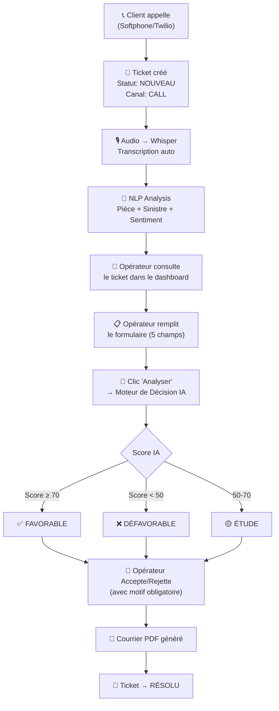

# 🎫 Analyse Complète du Cycle de Vie d'un Ticket

## Le Flux Complet : De l'Appel à la Décision



---

## 📋 Le Formulaire Opérateur — À Quoi Il Sert ?

Le formulaire à droite de la page ticket est le **formulaire de saisie de la demande**. C'est l'étape **CRITIQUE** du processus.

### Les 5 champs obligatoires :

| Champ | Exemple | Pourquoi c'est nécessaire |
|---|---|---|
| **Type de pièce** * | `PARE_BRISE`, `MOTEUR` | Quelle pièce est réclamée |
| **Âge du véhicule** * | `5` (ans) | Véhicule trop vieux = défavorable |
| **Kilométrage** * | `80000` | Usure normale vs défaut |
| **Catégorie client** * | `PARTICULIER`, `PROFESSIONNEL` | Clients pro = règles différentes |
| **Type de sinistre** * | `ACCIDENT`, `PANNE` | Type de couverture |
| Référence pièce | `PB-2024-001` | Optionnel, pour traçabilité |

### Pourquoi l'opérateur doit remplir ces champs ?

> L'IA **NLP détecte** la pièce et le sinistre depuis la transcription audio, **MAIS** l'opérateur doit **confirmer et compléter** les informations.
> 
> Exemple : Le client dit *"mon pare-brise est cassé suite à un accident"*
> - NLP détecte : pièce=PARE_BRISE, sinistre=ACCIDENT ✅
> - **MAIS** l'âge du véhicule et le kilométrage ne sont PAS dans l'audio
> - L'opérateur doit les saisir manuellement

---

## 🤖 Le Moteur de Décision IA

Quand l'opérateur clique **"Analyser"**, voici ce qui se passe :

```
Formulaire (5 champs) → decision-service → Moteur de Règles
                                              ↓
                                  Évalue TOUTES les règles actives
                                  (conditions + scores)
                                              ↓
                                  Score final (0-100%)
                                              ↓
                              ≥70% → FAVORABLE
                              <50% → DÉFAVORABLE  
                              50-70% → ÉTUDE (à revoir)
```

### Après la décision IA :
1. L'opérateur voit la **suggestion IA** (FAVORABLE/DÉFAVORABLE) + le score
2. Il peut **Accepter** ✅ ou **Rejeter** ❌ la suggestion (avec motif obligatoire)
3. Un **courrier PDF** est généré automatiquement
4. Le ticket passe en **RÉSOLU**

---

## ⚠️ Problèmes Identifiés

### Problème 1 : Transcription affichée ou non ?
- Si `ticket.audioPath` est NULL → affiche *"Enregistrement automatique en cours"*
- Si `ticket.audioPath` existe MAIS `ticket.transcription` est NULL → affiche *"Transcription en cours..."*
- Si les DEUX existent → affiche la transcription complète ✅

**Avec le nouveau softphone** : L'audio est uploadé via `POST /api/tickets/{id}/audio` qui met à jour `audioPath` ET `transcription`. Donc la transcription devrait s'afficher. **Rafraîchir la page** après l'appel pour voir la mise à jour.

### Problème 2 : Champs du formulaire non pré-remplis
- La NLP détecte pièce/sinistre mais le formulaire ne se pré-remplit pas
- L'opérateur doit saisir manuellement

---

## 🧪 Test Complet : Du Début à la Fin

### Étape 1 : Créer un ticket via Softphone
1. Ouvrir `http://localhost:8000/softphone`
2. Remplir nom + téléphone + agence
3. Cliquer 📞 et dire : *"Bonjour, j'ai un problème avec mon pare-brise suite à un accident"*
4. Raccrocher → Ticket créé automatiquement

### Étape 2 : Consulter le ticket
1. Cliquer le lien "Voir le ticket dans le dashboard"
2. Vérifier : transcription visible, audio path existant

### Étape 3 : Remplir le formulaire opérateur
1. **Type de pièce** → `PARE_BRISE`
2. **Âge véhicule** → `3`
3. **Kilométrage** → `50000`
4. **Catégorie client** → `PARTICULIER`
5. **Type de sinistre** → `ACCIDENT`

### Étape 4 : Lancer l'analyse IA
1. Cliquer **"Analyser"**
2. Le moteur de décision évalue les règles
3. Résultat : FAVORABLE/DÉFAVORABLE + score

### Étape 5 : Décision finale
1. Saisir un motif : *"Dossier conforme, pièce justificative fournie"*
2. Cliquer ✅ **Accepter** ou ❌ **Rejeter**
3. Courrier PDF disponible au téléchargement
4. Ticket → RÉSOLU automatiquement
